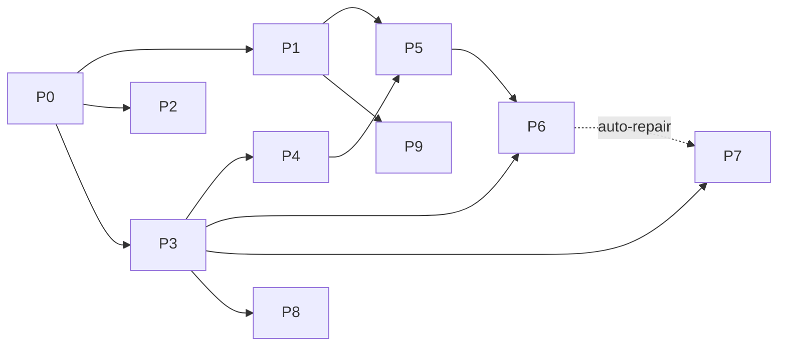

# Launcher systems overhaul - architecture decisions

## 0. Conclusions first
| Decision | Pick | One-line why |
|---|---|---|
| (a) per-profile mod sets + managed versions | **A1: immutable component store + per-profile pins, materialised into the launch folder that already exists** | Reuses LaunchModFolder.LaunchSet/Sync (the hard part is built); shared mods/ and the no-profile launch stay exactly as today. |
| (b) compatibility engine | **B1: promote Core/Import/Mods to Core/Compat with Check -> Plan -> Apply; Fabric Loader itself as the CI oracle** | The resolver is already pure and tested (ModSetResolver.Resolve takes SourceMod[]); four callers need one verdict, not four. |
| (c) crash rule model + tests | **C2: typed evidence facts, then ordered C# predicate rules with a confidence level; folder corpus of real logs** | Today's one concatenated string loses which file said what; facts make confidence honest and rules testable one by one. |
| (d) 1.8.9 preset bundle | **D1: launcher writes options.txt + optionsof.txt (extend PresetWriter), snapshot for Undo, refuse while that account's game runs** | PresetWriter already does this for options.txt (Low/Balanced/High, own keys only); headless-testable; no Java code. |

Merge first: `claude/launch-crash-fix2` (clean merge today), then `claude/shots-and-update-hash` (3 conflicts, risk-floor review).

**Riskiest assumption: Origin's own mixins into Sodium/Iris internals survive an alternate Sodium/Iris build.** Every Fabric module has 9-24 Java files touching `net.caffeinemc` / `net.irisshaders` / `jellysquid` (grep, verification log), so "pick any compatible Sodium" is false by default. Cheapest experiment: one boot-smoke CI run on 1.21.11 (catalog-installed perf stack, nothing nested) with Sodium swapped to the previous minor build, `-Dmixin.debug.export=true`, grep `Mixin apply .* failed` and Origin's self-check lines. The result decides whether Sodium/Iris alternates are a small CI-proven matrix (expected) or not viable (then per-profile pins cover Fabric API + user mods only).

Second assumption (1.21.1 only): 1.21.1's originclient jar nests Sodium, Indium, Lithium, FerriteCore, ImmediatelyFast, ModernFix, Iris, JEI and ModMenu jar-in-jar (src/mods/versions/1.21.1/build.gradle:157-178; no other module nests Sodium/Iris). Whether Fabric Loader 0.19.3 prefers a top-level jar over a nested one of the same id is unproven. Experiment: 1.21.1 boot-smoke with a top-level Sodium beside originclient; read the loader's mod list. If nested wins, 1.21.1 alternates first need a "no-nested" originclient build (the 1.21.11 model).

## 1. Context
Will wants: guided import with a report; one-click Fix Compatibility that never touches the original profile and allows different Sodium/Iris/Fabric API builds per profile; local-only crash diagnosis with a confidence level and safe auto-fixes; undoable 1.8.9 Competitive/Balanced/Quality presets; developer mode out of the user UI. The audit (launcher-systems.md) shows most raw parts exist but each is wired to one caller: the resolver runs only on import (grep ModSetResolver|ModMetadataReader outside Core/Import: 0 hits), profiles cannot hold managed jars, crash DisableMod ignores profiles (HomePage.xaml.cs:1228) and its fallback flips PlayWithExternalMods for good (HomePage.xaml.cs:653-666).

## 2. Current state (verified paths)
- Launch: VersionManager.cs:603-633. No profile + external mods on -> fabric.modsFolder = shared `instances/<v>/mods`. Origin-only or a profile -> per-account `<account>/mods-origin-only` or `<account>/mods-profile`, built by `LaunchModFolder.LaunchSet(shared, profile, isOriginJar)` and diff-synced by `LaunchModFolder.Sync` (copy beside + rename, locked extras left, never rewritten in place).
- LaunchSet takes Origin jars ONLY from the shared folder (LaunchModFolder.cs:28-43) and drops a profile jar that looks like Origin's (ModManager.IsOriginProvisioned, ModManager.cs:283; filename shapes :264-290).
- Profile = ModProfile {Id, Name, Version, ServerName, ServerAddress, Tint, Icon} in settings.json (ModProfile.cs); jars in `instances/<v>/profiles/<id>/mods` (OriginPaths.ProfileModsDir).
- Catalog: PerformanceModCatalog.Data.cs, one SHA-512 pinned PerfMod per family per MC version (PerfMod.cs:17). Fabric API, Simple Voice Chat, legacy Forge, 1.8.9 stack: live and/or unhashed (audit section 6).
- Compat: Core/Import/Mods: ModMetadataReader (305 lines), VersionPredicate (242), BuiltInModSet (124), KnownIncompatible (60), ModSetResolver (230; pure `Resolve(IReadOnlyList<SourceMod>, ResolveContext) -> List<ModDecision>`).
- Crash: `CrashClassifier.Classify(CrashAnalysis, string evidence, exitCode, ram, totalRam, actionTried)`: EarlyRows regex table, then mod blame, then LateRows (CrashClassifier.cs:23-80). CrashModels: CrashCause (7), CrashAction (6), CrashDiagnosis (one action). CrashAnalyzer/CrashDiagnoser untested on main.
- Presets: Core/Performance/PerformancePreset.cs: TierPicker, `PresetOptions.For(tier, version)` already has a legacy (<1.13) key branch, `PresetWriter.ApplyToNewInstance` (only when no options.txt) and `ApplyNow` (explicit click, own keys only). Callers HomePage.xaml.cs:884, SettingsPage.xaml.cs:214. No optionsof.txt, no undo.
- Dev mode: SettingsPage.xaml:315-331 "Developer (temporary: remove before public release)", OfflineTestToggle (SettingsPage.xaml.cs:249-260); `UpdateService.IsDevBuild` exists (UpdateService.cs:56). Harnesses set OfflineTestMode in code (LaunchTimingHarness.cs:52).

## 3. Decision (a): where per-profile mod sets and managed-component versions live

| | A1 Component store + pins (PICK) | A2 Each profile holds full copies of its managed jars | A3 Profile = full instance (Prism model) |
|---|---|---|---|
| How | Immutable `OriginPaths.ComponentStore` = `<Root>/components/<family>/<sha512-12>/<file>`, each file written once (temp, hash check, rename), never modified. Profile gains `ComponentPins` (family -> pinned version id; absent = the version's default). LaunchSet takes managed jars from the store when pinned, else from the shared folder as today. | `profiles/<id>/mods` also holds Sodium/Iris/Fabric API copies; LaunchSet takes everything from the profile. | Profile gets its own game dir (config, options, worlds, packs). |
| Build cost | Medium: store + reuse PerfModInstaller's hash path, LaunchSet overload, pin field, catalog alternates. | Low-medium, but every catalog bump walks every profile folder. | High: GameFolders, Settings Sync, import destinations, crash paths all change. |
| Startup | none | none | none |
| Launch latency | Unchanged when the set is unchanged (Sync only stats). A pin change = one local copy per changed jar. | Same | Same |
| Disk | One copy per distinct build + launch-folder copies (as today). | One copy per profile per jar. | Full duplication of configs/packs. |
| Stability | Shared mods/ never touched by profiles or repairs; store write-once so no running game can be hurt; a damaged store file fails its hash and is re-fetched. | Profile folder is only read at launch, so safe; drift vs catalog likely. | Breaks one game folder per account (Will 2026-10-12) and the import model. |
| Rules out | Nothing; hardlinks store -> launch folder can come later as a pure optimisation. | Central security re-pins become N-folder migrations. | Shared worlds/options across profiles. |

**Pick A1.** It reuses the launch-folder mechanism that already isolates accounts, keeps the shared folder's add/delete/rename-swap rule trivially true, and keeps one catalog as the authority. Simplicity tie-break: one new folder, one new field, one LaunchSet overload.

Constraints the pick carries:
- **Pins are restricted to an Origin-vetted matrix**, not "any version that satisfies depends". The catalog gains `Alternates` per family per MC version, each SHA-512 pinned and each added only after a green boot-smoke + mixin-apply check against that module's originclient build (data-only additions after the first). Fabric API is the easy case (originclient declares `"fabric-api": "*"`, fabric.mod.json:39); Sodium/Iris are the hard case (section 0).
- **Fabric API joins the catalog with SHA-512 pins** (today live-queried and unhashed). Per-profile Fabric API is meaningless without a pinned identity.
- **"Managed" becomes metadata, not filename shape**: managed = SHA-512 in catalog/store, or originclient; the filename heuristic stays only as a fallback for unreadable jars. Closes the user-jar-treated-as-managed gap (ModManager.cs:264-290).
- **Pins stored as one string field** (`ComponentPins`, e.g. `sodium=<id>;fabric-api=<id>`), the ImportedSetupsJson precedent, so a bad value can never make SettingsStore.Load reset all settings. Written only via SettingsStore.Update.
- **"No profile" stays the shared folder's loose jars.** A repair starting from "No profile" creates a new profile that copies those loose jars (minus the problem) into profiles/<new>/mods. A repair never edits the shared folder.
- Launch folder per account AND profile (`mods-profile-<id>` instead of one `mods-profile`) so two profiles of one account never share a half-synced folder. Costs one copy set per used profile.

Known risk: Sodium/Iris write config into the account's shared `config/`; a profile on a newer schema can rewrite it for a profile on an older one. Mitigation: alternates limited to the same config generation unless proven; a per-profile config overlay is a later, separate decision.

## 4. Decision (b): one compatibility engine

| | B1 Core/Compat: Check -> Plan -> Apply (PICK) | B2 Keep import resolver; reactive check parses Fabric's error after a failed boot | B3 Run Fabric Loader's own solver pre-launch |
|---|---|---|---|
| How | Move ModMetadataReader, VersionPredicate, BuiltInModSet, KnownIncompatible, ImportedModFit (branch) into `Core/Compat/`; ModSetResolver becomes the import adapter. | Leave code; crash path learns more Fabric error shapes. | Spawn a JVM with Fabric Loader against the candidate set. |
| Cost | Medium (mostly moves + 2 pure types + 1 executor) | Low | High (no supported dry-run; needs Java + Knot) |
| Latency | Cached verdict keyed by the launch-set fingerprint (names + sizes + mtimes, already statted by Sync): zero jar opens when unchanged; ModInfo cache on disk. | None pre-launch; player eats a failed boot first. | A JVM start before every changed launch (not measured) |
| Stability | One verdict for every caller; pure parts unit-tested. | Fails "BEFORE launch". | Exact fidelity, fragile coupling to loader internals. |
| Rules out | Nothing; B3 stays available as CI oracle. | Pre-launch repair. | Fast launches. |

**Pick B1, with Fabric Loader as the CI oracle** (differential test: for each planted mod set, the engine's verdict must agree with what a real headless boot reports). Interfaces (pure except the executor):

```
Core/Compat/
  ModSnapshot    IReadOnlyList<ModEntry>; ModEntry {Path, FileName, Enabled, Role: Managed|Profile|SharedLoose|ImportCandidate, Sha512?, ModInfo}
  Platform       McVersion, Loader {Fabric|Forge189, version}, JavaMajor, BuiltIns (BuiltInModSet), VettedMatrix (catalog + alternates)
  ModInfoCache   (path,size,mtime) -> ModInfo, JSON at OriginPaths.ModInfoCache; the only code that opens jars
  CompatEngine.Check(ModSnapshot, Platform) -> CompatReport { Issues[] }
    CompatIssue { Kind: WrongMc|WrongLoader|DuplicateId|MissingDep|DepVersion|Breaks|KnownIncompatible|JavaTooOld|ManagedVersionConflict|Unreadable,
                  Subjects (ids + jars), Blocking, Evidence (exact depends/breaks text), Confidence }
  RepairPlanner.Plan(CompatReport, ModSnapshot, Platform) -> RepairPlan
    Steps: CreateProfileFrom(source) | PinComponent(family, versionId) | AddTrustedDep(id, pinned artifact) | ExcludeFromProfile(jar, reason)
    Unfixable[]: (issue, plain reason)  -> the "why there is no fix" text
  RepairExecutor.Apply(RepairPlan) -> RepairResult   the ONLY writer; journaled like ImportTransaction;
    writes: new profile folder, component store, SettingsStore.Update. Never deletes; never touches shared mods/ or the source profile.
```

Callers: ImportEngine.PlanMods (Check on import candidates); ModManager.Import (Check before the rename lands; today it silently overwrites, ModManager.cs:153-210); pre-launch in VersionManager just before LaunchModFolder.Sync (Blocking issues -> Fix Compatibility prompt with "Launch anyway"; non-blocking -> launch); crash repair (CrashAnalyzer culprits become CompatIssues so the same planner builds the repaired profile).

"Trusted deps" = only artifacts with a pinned hash: Origin's catalog, or a Modrinth version whose published SHA-512 matches the downloaded file. Whether the launcher may query Modrinth to find a missing dependency is an open question (sends mod ids/hashes to an external service).

## 5. Decision (c): crash diagnosis rule model and test strategy

| | C1 Extend the regex row table | C2 Facts, then predicate rules (PICK) | C3 Data-driven rule file (local or fetched) |
|---|---|---|---|
| How | Add Confidence to Row; keep one concatenated evidence string. | `CrashEvidence` parser -> `CrashFacts`; rules are C# predicates over facts returning a `Finding`. | JSON/YAML rules shipped or fetched like promos.json. |
| Cost | Low | Medium | Medium-high (rule language, parser, validation) |
| Latency | Regex over the 512 KB tail (as today) | Same reads, parsed once; post-crash only, no hot path | Same + parse |
| Stability | Can't tell "crash report says X" from "a log line quoted X"; confidence would be a guess. | Each rule tested alone; confidence comes from evidence type. | Fetched rules that trigger auto-fixes are an attack surface. |
| Rules out | Honest confidence. | Nothing. | - |

**Pick C2.**
- `CrashFacts` (pure parse): exit code, StoppedByPlayer, clean-shutdown marker in latest.log, crash-*.txt sections incl. "Suspected Mods", hs_err "Problematic frame" module + JRE version, latest.log + launch-log tail, Fabric "Incompatible mods found"/requires blocks, Forge FML tables, Mixin apply failures with their config name, exception cause chain (deepest first), Java major, RAM, and the launch mod set (ModSnapshot). Today latest.log is not read at all (audit section 4).
- **Crash vs normal close**: not a crash when exit 0, StoppedByPlayer, or a clean-shutdown marker with no new crash file. Keep the boot-time rule but read latest.log first (today a kill during boot still shows the window).
- Rule = `Func<CrashFacts, Finding?>`, ordered; the first strong-or-better wins, weaker findings go under Technical details. `Finding {Cause, Confidence, Culprits, WhatHappened, LikelyCause, RecommendedFix, AutoFix: RepairPlan? (null when unsafe), TechnicalLines}` maps 1:1 to the five UI sections.
- Confidence: **confirmed** = the loader/JVM names the cause in a structured message (Fabric dependency block, UnsupportedClassVersionError, OutOfMemoryError); **strong** = a mixin apply failure in one mod's config, or a single "Suspected Mods" entry matching a jar in the launch set; **possible** = stack-package match, or a native frame in a GPU driver DLL; **unknown** otherwise. Auto-fix only at confirmed/strong.
- Auto-fixes go through RepairPlanner/RepairExecutor (a new repaired profile, or a reversible setting change with the old value kept for Undo). DisableMod's global fallback (PlayWithExternalMods) is removed. RaiseMemory stays (reversible, capped by RamAdvice).
- Local only: nothing uploaded; "Copy report" keeps CrashReportBundle's scrub.

Test strategy:
- Corpus folder `src/OriginLauncher.Tests/CrashCorpus/<case>/`: raw files as found (`latest.log`, `crash-*.txt`, `hs_err_pid*.log`, `exit.txt`, `mods.txt` = launch set) + `expected.json` {cause, confidence, culprits, autoFix kind}. One xunit Theory walks every folder. Fixtures pass CrashReportBundle's scrubber before commit; a test asserts no user-name/token/email patterns anywhere in the corpus.
- Seeds: CrashFixtures.cs on launch-crash-fix2 (real 2026-10-20 Feather log) converted to a folder; Will's local crash-reports/logs (read-only, scrubbed); **CI-generated real crashes**: a boot-smoke variant per case plants one defect (duplicate mod id, missing dependency, wrong-MC jar, mixin with a missing target, `-Xmx64m` OOM, unknown JVM option, truncated jar) and uploads the produced logs as corpus candidates. Most of the corpus becomes real logs without waiting for players.
- Gates: each rule has at least one positive and one negative fixture; the run prints the unknown rate over the corpus (reported, not invented); flipping any expected.json fails CI.
- Link CrashAnalyzer/CrashDiagnoser tests (linked but untested on main; the branch adds CrashAnalyzerTests).

## 6. Decision (d): where the 1.8.9 preset bundle lives

| | D1 Launcher writes options.txt + optionsof.txt (PICK) | D2 In-game row in the 1.8.9 mod (reflection into OptiFine fields), FPS Coach Keep/Undo | D3 Both |
|---|---|---|---|
| Cost | Low-medium: extend PresetOptions/PresetWriter (legacy branch exists) | Medium: Java + reflection + UI in the 1.8.9 module | Highest |
| Perf | Zero runtime cost; applied before launch | Live switch; FPS Coach can measure | Both |
| Stability | Must not write while that account's 1.8.9 game runs (MC rewrites options on exit); key names must be verified | Field names unverified too; CI 1.8.9 runs without OptiFine (perf-189.md:25), hard to test | Two writers of one file |
| Testability | Pure, headless, temp folders (PresetWriter pattern) | Needs a production-like 1.8.9 CI stack | - |
| Rules out | Live measured A/B (addable later via FPS Coach) | Applying before the first launch | - |

**Pick D1.** Bundle = `PresetOptions.For(Competitive|Balanced|Quality, "1.8.9")` returning keys per file (options.txt, optionsof.txt; Origin's own config keys only if Will wants them). Undo: before writing, save the prior value of every touched key (absent recorded as absent) to `<account game dir>/origin-preset-undo.json` (own file, via an OriginPaths member); Undo restores exactly those keys. Never silent: applied only on the player's click, with a preview of what changes; never re-applied on launch; the label shows "Custom" once any preset key differs from the bundle. ApplyToNewInstance keeps its "only when no options file exists" rule.

## 7. Requirement 5: developer mode out of user UI
- Gate the Settings "Developer" card and rail item on `UpdateService.IsDevBuild || ORIGIN_DEV=1` (hide, keep the setting). Harnesses are unaffected: they set OfflineTestMode in code (LaunchTimingHarness.cs:52); the CLI flags (--render-shots, --import-plan, --launch-timing, --startup-trace, --import) are not UI.
- On a release build, clear a saved OfflineTestMode=true at startup unless a harness flag/env is present; otherwise a player who once toggled it is stuck with no switch.
- Removing the last rail section changes the scroll-spy end case (launcher-ui.md section 6): fix together.
- Do it after the shots-and-update-hash merge (that branch touches SettingsPage.xaml/.cs too).

## 8. Phases (each shippable and testable alone)

| # | Phase | Type | Depends on | Owner (lane) |
|---|---|---|---|---|
| P0 | Merge `claude/launch-crash-fix2` (clean `git merge-tree` vs origin/main; 22 behind; adds ImportedModFit, ClientCoreMods, CrashAnalyzer tests + real-log fixture). Then rebase/merge `claude/shots-and-update-hash` (359 behind; conflicts in UI/ImportShots.cs, UI/Pages/SettingsPage.xaml, UI/RenderShots.cs) with an opus security code-review (self-update = risk floor). Delete superseded `claude/launch-crash-fix` and `claude/import-flow` after Will's OK. | spec | - | launcher coder (sonnet) + code-reviewer (opus, risk floor) or verifier |
| P1 | Experiments: (1) Sodium alternate on 1.21.11 boot-smoke + mixin export; (2) 1.21.1 top-level vs nested Sodium; (3) OptiFine M5 optionsof.txt key names via javap on the cached M5 jar's save method. | experiment | P0 | verifier / launcher coder |
| P2 | Dev-mode gating + OfflineTestMode reset + rail fix. | spec | P0 | ui-builder |
| P3 | Core/Compat move (no behaviour change, import tests stay green) + ModInfoCache + CompatEngine.Check; csproj links Core/Compat/** wholesale. Measure cold/warm Check on a 150-jar set. | spec | P0 | launcher coder |
| P4 | Integrity: Fabric API (+ SVC) into the catalog with SHA-512 pins; legacy Forge + 1.8.9 stack pinned; hash-based "managed" with filename fallback. | spec | P3 | launcher coder |
| P5 | Component store + ComponentPins + LaunchSet overload + per-profile launch folder; first alternates = Fabric API only. | spec | P4, P1(1) | launcher coder |
| P6 | Pre-launch check + ModManager.Import check + Fix Compatibility (RepairPlanner/Executor, new repaired profile, original untouched). Sodium/Iris alternates only for builds P1/CI proved, added as data. | spec, then tuning | P3, P5 | launcher coder + ui-builder |
| P7 | Crash v3: CrashFacts + rules + confidence + 5-section window; corpus + CI defect-planting job; remove DisableMod/OriginOnly global fallback; repairs via the P6 executor. | spec | P3 (P6 for auto-repair) | launcher coder + ui-builder |
| P8 | Guided import UI: one launcher, "Import everything" or categories, progress, final report (succeeded/skipped/unsupported/failed) from ImportEngine's plan + Check. Profile-per-source only if Will reverses the 2026-10-19 "imports never make a profile" call. | spec | P3 (P5 if imports create profiles) | ui-builder + launcher coder |
| P9 | 1.8.9 presets: bundles + optionsof.txt + undo snapshot + running-game guard + Settings UI. | spec, then tuning | P1(3) | launcher coder + ui-builder |

Critical path: P0 -> P3 -> P4 -> P5 -> P6. P2, P7 (without auto-repair) and P9 can run in parallel worktrees after P0/P1.



## 9. Cross-cutting
- Data: new persisted state is a string field in LauncherSettings (ComponentPins) or its own file (ModInfoCache, component store, origin-preset-undo.json, repair journal); never a typed object whose parse failure resets settings.
- Paths: each new folder gets an OriginPaths member (ComponentStore, ModInfoCache, RepairJournal, PresetUndo); nothing outside %LocalAppData%\OriginLauncher.
- Perf budget: zero added startup work; pre-launch adds only stats when the launch set is unchanged (fingerprint hit); jars opened only on change via ModInfoCache. No timings are claimed here; P3 measures them.
- Concurrency: shared mods/ keeps add/delete/rename-swap; the store is write-once; repairs write only new folders; newest launch action per account still cancels in-flight work.
- Debug visibility: each Check/Plan/Apply logs one line per issue/step; Technical details lists the facts each rule used.
- Security: no uploads; every download hash-verified; the self-update hash (P0) lands before any new downloader.

## 10. Proof split
Headless in CI:
- CompatEngine/RepairPlanner unit tests; Fabric Loader differential test on planted mod sets (boot-smoke).
- Each alternate component build: boot-smoke + mixin-apply grep per (module, alternate) before it enters the matrix.
- Crash corpus Theory, scrub test, CI defect-planting crashes, unknown-rate report.
- 1.8.9 PresetWriter bundles, undo round-trip (apply then undo leaves every touched key as before), running-game refusal.
- Store hash checks, LaunchSet with pins, per-profile launch-folder sync, settings parse safety.
- launcher-shots renders of the Fix Compatibility prompt, 5-section crash window, import report; UiTests that the Developer card is hidden on a release build.
- Self-update verification (branch tests UpdateVerifierTests, UpdateGateTests, UpdateCleanupTests).

Needs Will's eyes:
- A real import from his own Lunar/Prism/etc. in a real launcher window (never run so far).
- Whether Fix Compatibility and "why there is no fix" text read clearly.
- Two profiles with different Fabric API (later Sodium) builds played back to back on one account: no config reset, no broken menus.
- Real crash recovery on his PC (GPU driver, hs_err, other-client jars); whether the confidence label feels right.
- 1.8.9 presets: FPS and look on real servers; Fast Render with Origin's MenuBlur/ColorGrade/MotionBlur.

## 11. Risks
| Phase | Risk | Mitigation |
|---|---|---|
| P0 | shots-and-update-hash is 359 behind; UI conflicts | Resolve the 3 files only; CI shots + update tests green; opus security review |
| P1 | Alternates fail mixin apply | Sodium/Iris matrix stays empty on that module; Fabric API alternates still ship |
| P3 | Namespace move unlinks tests silently | Link Core/Compat/** wholesale; test count must not drop (1434 on de6b3eb6a) |
| P4 | Pinning Fabric API makes a Modrinth outage fail launches (PerfModInstaller already throws on mismatch) | A cached verified jar launches offline; a mismatch never deletes the last good copy |
| P5 | Sodium/Iris config schema drift between profiles | Same-generation alternates only |
| P6 | Pre-launch false positives block play | Only Blocking issues prompt; "Launch anyway" always offered |
| P7 | Over-confident rules | Auto-fix only at confirmed/strong; negative fixtures per rule |
| P8 | "profiles/instances" category conflicts with the 2026-10-19 no-profile import decision | Will decides |
| P9 | Wrong OptiFine keys silently ignored | P1(3) javap check + a test that bundles use only verified keys |

## 12. Open questions (for Will)
1. Approve picks A1, B1, C2, D1?
2. Import: should importing another launcher's profiles/instances now create Origin profiles (reverses commit bdcd7dc5a, 2026-10-19 "imports never make a profile"), or keep landing in the shared folder?
3. May Fix Compatibility look up missing dependencies on Modrinth (sends mod ids/hashes; downloads checked against Modrinth's SHA-512), or only use Origin's own catalog?
4. Is a preset button OK under "one control, one job" if explicit, previewed and undoable?
5. Should 1.8.9 presets include Origin's own toggles (Menu Blur, Entity Distance, cosmetics) or only vanilla + OptiFine?
6. OK to delete superseded branches claude/launch-crash-fix and claude/import-flow after P0?

## Code verification log
| Claim | Check | Result |
|---|---|---|
| LaunchSet takes Origin jars only from shared | Read LaunchModFolder.cs:28-43 | confirmed |
| Profile launch folder per account, diff sync | Read VersionManager.cs:603-633, LaunchModFolder.cs:56-86 | confirmed |
| ModProfile fields | Read ModProfile.cs | confirmed (no pins, no loader) |
| Resolver only used by import | grep ModSetResolver/ModMetadataReader outside Core/Import | 0 hits |
| Resolve is pure over SourceMod[] | Read ModSetResolver.cs:1-60 | confirmed |
| Classifier = regex rows over one string | Read CrashClassifier.cs:13-80 | confirmed |
| DisableMod / PlayWithExternalMods fallback | grep HomePage.xaml.cs:1228, 1233, 653-666 | locations confirmed |
| One SHA-512 pin per family per version | Read PerfMod.cs; PerformanceModCatalog.Data.cs:84 | confirmed |
| Only 1.21.1 nests Sodium/Iris in originclient | grep include sodium/iris over versions/*/build.gradle | confirmed |
| Origin code touches Sodium/Iris internals in every Fabric module | grep caffeinemc/irisshaders/jellysquid per module | 9-24 files each (1.21.5: 2) |
| originclient depends fabric-api "*" | fabric.mod.json:39 (1.21.1, 1.21.11) | confirmed |
| PresetWriter exists, legacy branch, own keys only | Read PerformancePreset.cs:1-30; grep :88-172; callers HomePage:884, SettingsPage:214 | confirmed |
| Dev section, IsDevBuild, harness sets OfflineTestMode | grep SettingsPage.xaml.cs:249-260, UpdateService.cs:56, LaunchTimingHarness.cs:52 | confirmed |
| launch-crash-fix2 clean; shots-and-update-hash conflicts | git merge-tree --write-tree vs origin/main | confirmed (3 files) |
| "Imports never make a profile" was deliberate | git show bdcd7dc5a | confirmed |
| Fabric Loader prefers top-level over nested of same id | not checked | UNVERIFIED (P1 experiment 2) |
| OptiFine M5 optionsof.txt key names | not checked | UNVERIFIED (P1 experiment 3) |
